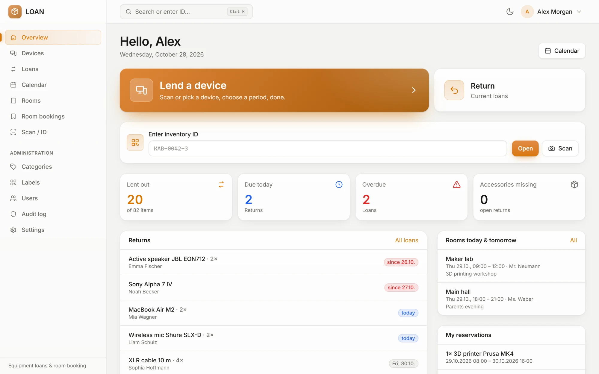
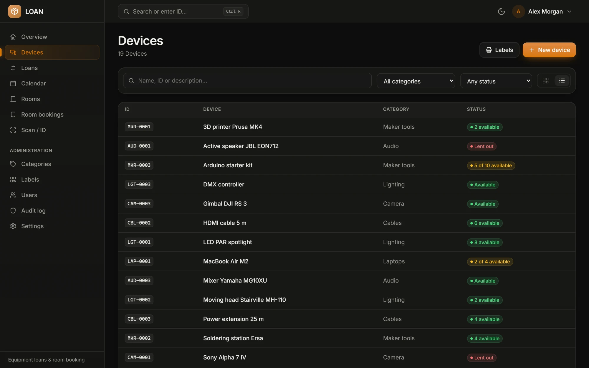
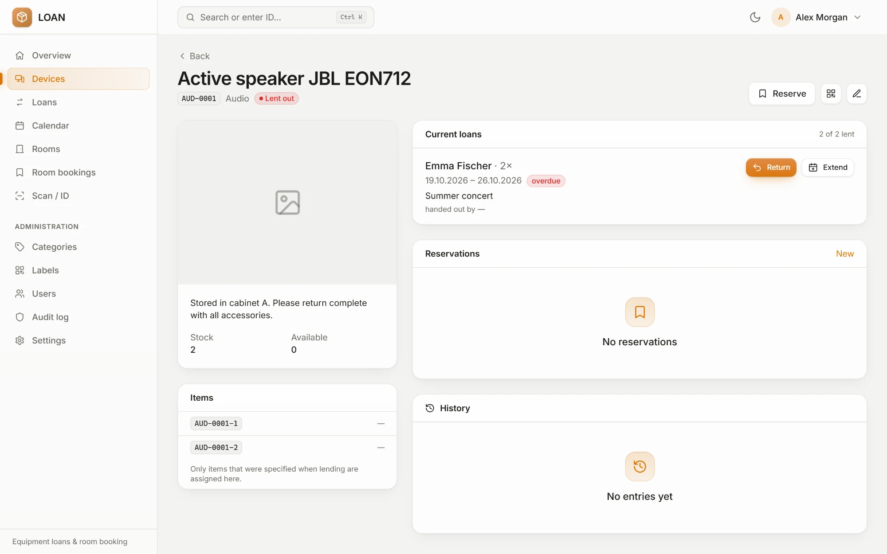
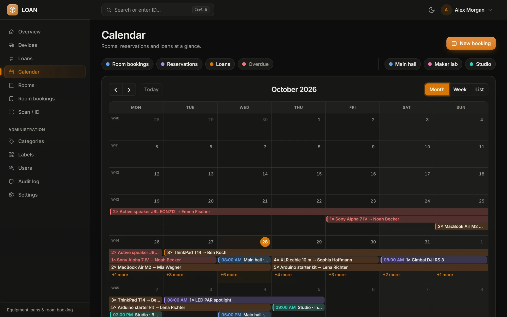
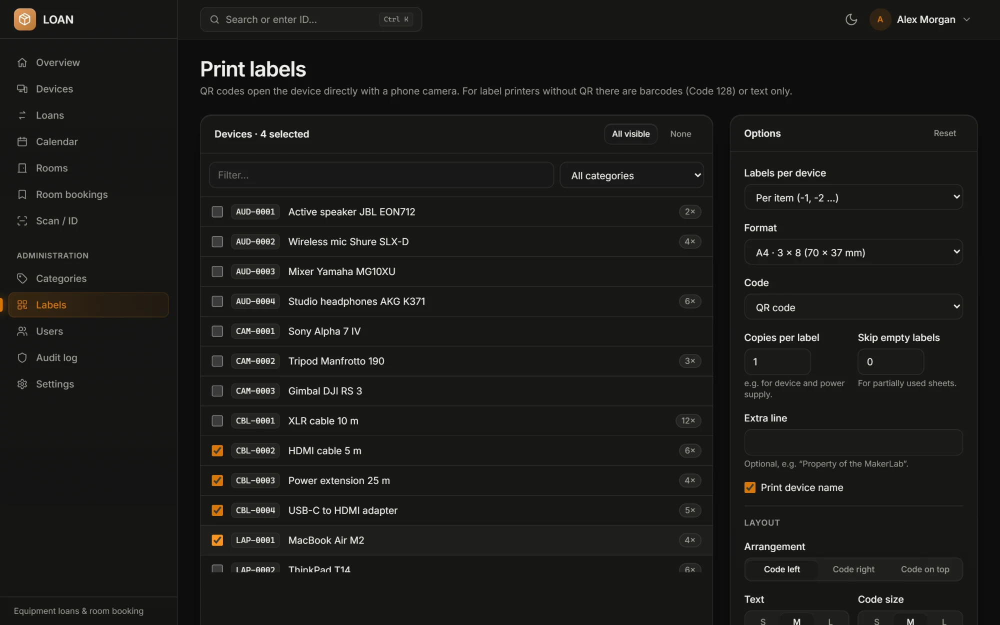
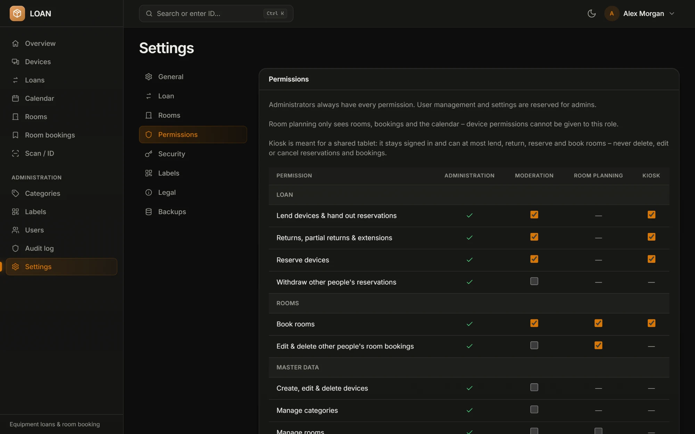
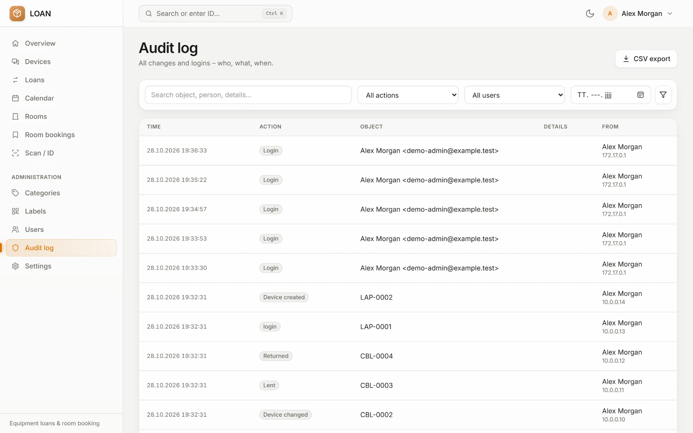
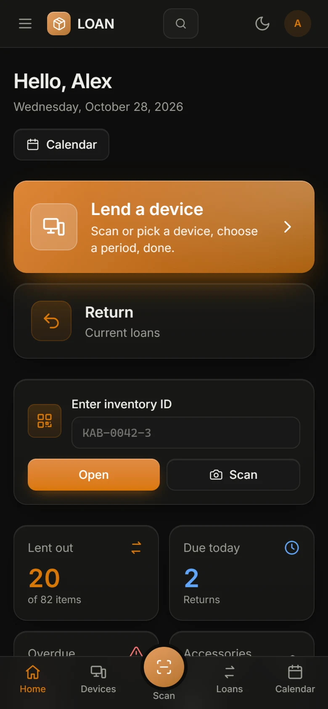
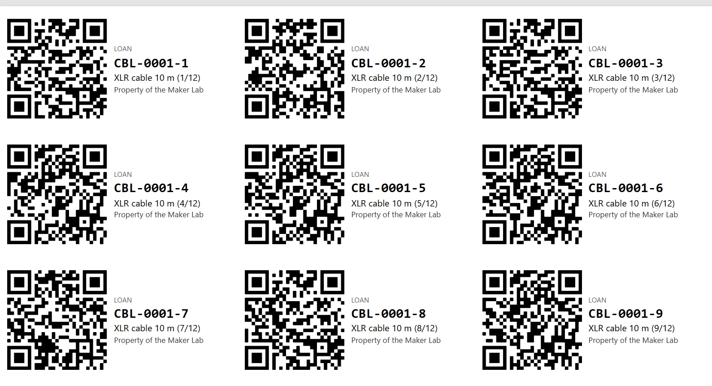

<div align="center">

# LOAN

**Self-hosted equipment loans and room booking for schools, maker spaces and clubs.**

Scan a QR label, pick a return date, done. Book rooms without double bookings.
Everything in one calendar, on any phone, tablet or desktop.

[](https://github.com/makerLab314/LOAN/actions/workflows/ci.yml)
[](https://github.com/makerLab314/LOAN/releases)
[](LICENSE)


<picture>
  <source media="(prefers-color-scheme: dark)" srcset="docs/screenshots/dashboard-dark.webp">
  
</picture>

[Features](#features) · [Screenshots](#screenshots) · [Installation](#installation) · [Labels and scanning](#labels-and-scanning) · [Updating](#updating-and-backups) · [Troubleshooting](#troubleshooting) · [Development](#development)

</div>

## Features

### Equipment

- **Inventory IDs** built from a category code and a number (`CBL-0042`). Each item of a device gets its own suffix (`CBL-0042-3`).
- **Devices** with category, photo, stock and an **accessory checklist** (power supply, case, cables) that is checked on return.
- **Lending** by quantity or by individual items, with **partial returns** and **extensions**. Missing accessories are recorded and shown on the dashboard.
- **Reservations** with an availability check. One click turns a reservation into a loan.
- **Return by scan**: scan the label, LOAN finds the matching loan.

### Rooms

- **Room bookings** with a live conflict check while you type, multi-day bookings and duration presets (45 min, 1 h, 2 h, all day).
- **Contact person** per booking and a day overview of all rooms right next to the form.
- A dedicated **room planning** role for people who only manage rooms.

### Labels and scanning

- **Labels** with a QR code, a Code 128 barcode, both, or text only.
- **17 ready-made formats** for A4 sheets (Avery, Zweckform), Brother DK rolls, Dymo rolls and P-touch tape, plus a **custom format** for anything else.
- **Layout options**: code left, right or on top, text and code size, cut lines for cable tags, logo, and a print offset to calibrate your printer.
- **Scanning** with any phone camera (the QR code opens the device directly), the built-in browser scanner, a USB hand scanner or by typing the ID. Typos like `cbl-42-3` are understood.

### Everyday use

- **Dashboard** with due, overdue and upcoming returns, reservations and today's rooms.
- **Calendar** for room bookings, reservations and loans with month, week and list views and one colour per room.
- **Global search** (<kbd>Ctrl</kbd> + <kbd>K</kbd>) for devices, IDs, people and rooms.
- **Kiosk mode** for a shared tablet at the equipment cabinet, and **installable as an app** (PWA).
- **Dark mode** (system, light, dark), **German and English**.

### Administration and security

- **Roles** (Administration, Moderation, Room planning, Kiosk) with a **permission matrix** you can adjust per role.
- **Settings in the browser**: name, logo, accent colour, time zone, lending rules, password rules, label defaults, imprint and privacy policy, backups.
- **Audit log** of every change and sign-in, with CSV export.
- **Content Security Policy**, server-side permission checks, login throttling, password confirmation for the admin area, session overview with "sign out everywhere".
- **Daily backups** of the database and uploads, plus a backup before every update.
- Uploaded photos are re-encoded: GPS and other metadata are removed, phone photos are rotated correctly.

## Screenshots

| | |
|---|---|
|  |  |
| **Devices** at a glance, filterable by category and status | **Device page** with current loans, items and history |
|  |  |
| **Calendar** with rooms, reservations and loans | **Label printing** with formats and layout options |
|  |  |
| **Permissions** per role | **Audit log** with CSV export |

<table>
  <tr>
    <td width="34%"></td>
    <td><br><br><b>Mobile first.</b> Every page works on a phone. The scan button sits in the middle of the bottom bar.<br><br><b>Print preview</b> of QR labels on an A4 sheet, ready for any office printer.</td>
  </tr>
</table>

## Installation

You need a Linux server with **Docker** and **Docker Compose**, and ideally a domain with HTTPS. LOAN ships as a ready-made image, so nothing has to be built on the server.

### 1. Get the code and create the configuration

```bash
git clone https://github.com/makerLab314/LOAN.git loan
cd loan
cp .env.example .env
```

Open `.env` and set at least these values:

| Variable | What to enter |
|---|---|
| `APP_URL` | The public address, e.g. `https://loan.example.org`. Links in emails are built from it, and requests for other host names are rejected. |
| `DB_PASSWORD`, `DB_ROOT_PASSWORD` | Two long random passwords. They are only used inside Docker. |
| `MAIL_*` | An SMTP account, needed for "forgot password" emails. |
| `APP_LOCALE`, `APP_TIMEZONE` | `de` or `en`, and your time zone. |

Then generate the application key and paste the output into `APP_KEY=` in `.env`:

```bash
docker compose run --rm --no-deps --entrypoint php loan artisan key:generate --show
```

### 2. Start LOAN

```bash
./deploy.sh
```

The script pulls the latest release from `ghcr.io/makerlab314/loan`, starts the containers and runs the database migrations.

### 3. Create the first admin

```bash
docker compose exec loan php artisan loan:create-admin you@example.org --name="Your Name"
```

The command prints a random password. Sign in with it, LOAN then asks you to choose your own.

### 4. Put HTTPS in front

LOAN listens on `127.0.0.1:8080` only, so a reverse proxy on the same host can serve it over HTTPS. With **Caddy** this is all you need, certificates included:

```caddyfile
loan.example.org {
    reverse_proxy 127.0.0.1:8080
}
```

With **nginx**, raise the upload limit as well. The default of 1 MB rejects photos straight from a phone with `413 Request Entity Too Large`:

```nginx
server {
    listen 443 ssl;
    server_name loan.example.org;
    # ssl_certificate and ssl_certificate_key as usual

    client_max_body_size 14m;

    location / {
        proxy_pass http://127.0.0.1:8080;
        proxy_set_header Host $host;
        # Overwrite, don't append: the client must not be able to add its own entries
        proxy_set_header X-Forwarded-For $remote_addr;
        proxy_set_header X-Forwarded-Proto $scheme;
    }
}
```

`TRUSTED_PROXIES=172.30.10.1` trusts exactly this proxy (it reaches nginx through the gateway of the Compose network). Never trust whole private ranges: clients in the school network live there too and could fake their IP. To run **without a proxy** (plain HTTP in a local network), set `APP_BIND=0.0.0.0`, `TRUSTED_PROXIES=` (empty), `SESSION_SECURE_COOKIE=false` and `APP_URL=http://your-server:8080`.

### 5. Set it up

1. **Settings → General**: name, logo, accent colour.
2. **Settings → Permissions**: check what Moderation, Room planning and Kiosk may do.
3. **Settings → Legal**: add your imprint and privacy policy.
4. **Categories**: create categories with short codes (`CBL`, `CAM`, `LAP`). The codes become part of the inventory IDs.
5. **Devices**: add your equipment, then print **Labels**.
6. **Users**: invite your team. New users have to set their own password on first sign-in.

### Where your data lives

| Folder | Content |
|---|---|
| `./data/db` | Database (MariaDB) |
| `./data/storage` | Photos, logos and other uploads |
| `./data/backups` | Daily backups and the backups taken before updates |

## Roles and permissions

| Role | Meant for | By default may |
|---|---|---|
| **Administration** | Whoever runs LOAN | Everything, including users and settings |
| **Moderation** | Staff at the equipment desk | Lend, take back, reserve, book rooms, print labels |
| **Room planning** | Office staff, timetable planners | Book rooms and edit other people's bookings. Devices are hidden. |
| **Kiosk** | A shared tablet at the cabinet | Lend, take back, reserve, book rooms. Never edit or delete. |

Everything except user management and settings can be granted or revoked per role under **Settings → Permissions**.

### Kiosk mode

Create a user with the **Kiosk** role and sign in with it on a tablet. The kiosk stays signed in, returns to the start page after two minutes without input, and hides personal data such as the global search and the loan history. Signing out needs the kiosk account's password. Add LOAN to the home screen to run it full screen like an app.

## Labels and scanning

**Which printer?** Any office printer works with A4 label sheets. Weatherproof **polyester film labels** last much longer than paper, especially on cables. For a dedicated label printer, a **Brother QL** model (e.g. QL-800 or QL-820NWB) is a good fit: it prints from the browser like a normal printer, the DK-11209 format is built in, and the DK-22212 film roll is very durable. Avoid printers that only work through a phone app, since LOAN prints through the browser's print dialog.

**Tips**

- Set the print scaling to **100 %** and the margins to **none**. If everything is shifted slightly, use **Correct print offset** on the label page.
- For cables, use small formats (48.5 × 16.9 mm, DK-11204, Dymo 11355) with **Code on top** or tags cut out along the **cut lines**.
- Keep QR codes at about **15 mm** or larger so every phone camera can read them.
- Not listed? Choose **Custom format** and enter the size from the label packaging.

**Scanning**

- The normal **phone camera** reads the QR codes and opens the device page directly.
- The **scanner page** in LOAN uses the camera in the browser. Browsers only allow this over **HTTPS**.
- **USB hand scanners** work like a keyboard. Scanners set to a US layout type `ß` instead of `-` on German systems; LOAN corrects that automatically.

## Updating and backups

`./deploy.sh` is the way to update. It takes a backup first and stops if that fails.

| Command | Effect |
|---|---|
| `./deploy.sh` | Backup, then update to the latest release |
| `./deploy.sh v2.1.0` | Switch to a specific version, e.g. back to the previous one |
| `./deploy.sh --build` | Build the image from the current branch instead of downloading it |

Database migrations are not rolled back when you switch to an older version. If the newer version changed the database, restore the backup from `./data/backups` first.

**Backups** run every night at 02:30 and are kept for 14 days. Both can be changed under **Settings → Backups**. A manual backup:

```bash
docker compose exec -u www-data loan php artisan loan:backup --force
```

**Coming from the original LOAN** by Vincent Dusanek or an older install? Follow [UPGRADE.md](UPGRADE.md) (in German) once, then use `./deploy.sh` as above.

## Troubleshooting

<details>
<summary><b>"413 Request Entity Too Large" when uploading a photo</b></summary>

The reverse proxy in front of LOAN rejects the upload. nginx allows only 1 MB by default. Add `client_max_body_size 14m;` to its `server` block and reload it. LOAN itself accepts photos up to 10 MB.
</details>

<details>
<summary><b>Photos from a phone appear sideways</b></summary>

Phones store photos sideways and add a rotation hint. Releases after v2.4.0 read that hint. Update with `./deploy.sh` and upload the photo again.
</details>

<details>
<summary><b>The camera scanner does not start</b></summary>

Browsers only allow camera access over HTTPS (or on `localhost`). Put LOAN behind a reverse proxy with a certificate. The phone's own camera app reads the QR codes without HTTPS.
</details>

<details>
<summary><b>Error page or links pointing to the wrong address</b></summary>

`APP_URL` has to match the address in the browser exactly, including `http` or `https` and the port. After changing it, run `docker compose up -d`.
</details>

<details>
<summary><b>Locked out of the admin account</b></summary>

Create a new admin from the server. The old account stays as it is.

```bash
docker compose exec loan php artisan loan:create-admin rescue@example.org --name="Rescue"
```
</details>

<details>
<summary><b>Where are the logs?</b></summary>

```bash
docker compose ps
docker compose logs -f loan
```
</details>

## Development

```bash
# PHP image with dev dependencies
docker build --target dev -t loan:dev .
docker run --rm -v "$PWD:/var/www/html" loan:dev composer install

# Tests and static analysis
docker run --rm -v "$PWD:/var/www/html" loan:dev php artisan test
docker run --rm -v "$PWD:/var/www/html" loan:dev vendor/bin/phpstan analyse
docker run --rm -v "$PWD:/var/www/html" loan:dev vendor/bin/pint

# Frontend with hot reload
npm ci
npm run dev
```

The [CI](.github/workflows/ci.yml) runs the tests, Pint, Larastan, `composer audit`, `npm audit` and a Docker build on every push and pull request.

**Tech stack:** Laravel 12, PHP 8.4, MariaDB 11, Tailwind CSS 4, Alpine.js (CSP build), FullCalendar, ZXing, Docker Compose with nginx.

### Releasing

```bash
git tag v2.5.0
git push origin v2.5.0
```

The [release workflow](.github/workflows/release.yml) runs the CI, builds the image for amd64, publishes it as `ghcr.io/makerlab314/loan:2.5.0`, `:2.5`, `:2` and `:latest`, and creates a GitHub release with the changes. The section `## v2.5.0` from [CHANGELOG.md](CHANGELOG.md) goes on top of the generated notes, so add it before tagging. Tags with a hyphen (`v2.5.0-rc.1`) become pre-releases: they do not get `latest`, and `./deploy.sh` without a version skips them.

## Credits and license

LOAN started as [dusanvin/LOAN](https://github.com/dusanvin/LOAN) by Vincent Dusanek and was largely rewritten by the [makerLab314](https://github.com/makerLab314) team. Released under the [MIT License](LICENSE).
